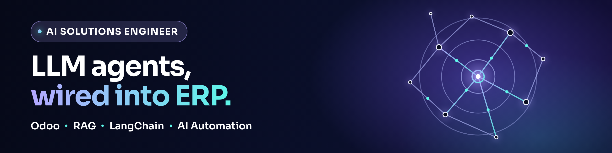

  

### Hi, I'm Marwan 👋

I'm an AI Solutions Engineer based in Cairo. I build AI agents and ERP systems that run in production:
agents that talk to customers on WhatsApp and phone calls, and Odoo systems that companies run their
daily operations on.

Right now I'm a Senior AI Solutions Engineer at AR-Corporates. Before that I was an AI Engineer and
Odoo Developer at EISAC Automation (a Siemens Authorized Partner), and I spent a little over a year at
Outlier reviewing and fixing LLM-generated code for model training.

  
  
  

### Production work

Most of what I build is for clients, so the code stays private. A few examples:

- A WhatsApp AI agent that connects management to their ERP: they ask about any figure and get a live answer, receive regular updates, and get alerted as soon as something looks off
- An AI agent for a restaurant that replies to customers, takes their orders and passes them to the kitchen
- WhatsApp and voice call agents that handle customer conversations
- A full Odoo 19 ERP for a supermarket chain: HR, attendance, payroll and sales, with integrations for biometric devices and the POS system
- An Odoo 19 ERP for a manufacturer and distributor, with payroll, quality control and GPS tracking for vehicles and sales reps

The two ERP systems have 32 custom modules and more than 6,500 automated tests between them.

### Open source

**[OdooBot AI](https://github.com/Marwankhater/AI_bot_for_odoo16)**
An LLM agent inside Odoo Discuss. You chat with it and it creates quotations, purchase orders and
customers, asking you to confirm before it writes anything. Odoo 16, LLaMA 3.3 70B on Groq, Python.

**[Restaurant Reservation Assistant](https://github.com/Marwankhater/restaurant_Chatbot_assistant)**
A Rasa chatbot that books tables in Arabic and checks availability in SQLite.

**[Deepfake Detection](https://github.com/Marwankhater/DEEP-FAKE-DETECTION)**
My graduation project (graded Excellent). MTCNN for face detection plus a CNN classifier trained with
transfer learning and augmentation, in TensorFlow/Keras.

### Tools I use most

  
  
  
  
  
  
  
  
  
  
  
  

Open to AI/ML roles and ERP or automation projects. Feel free to reach out.
